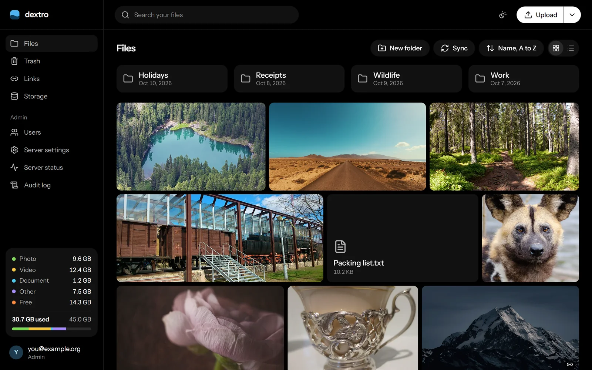
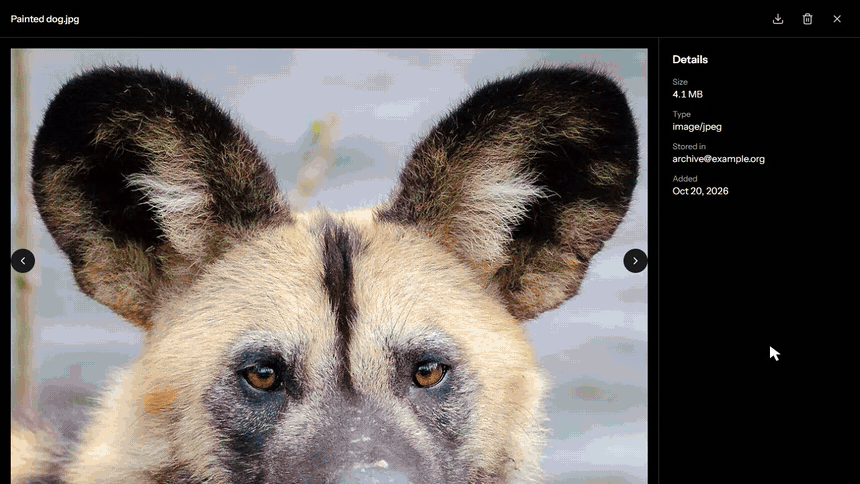
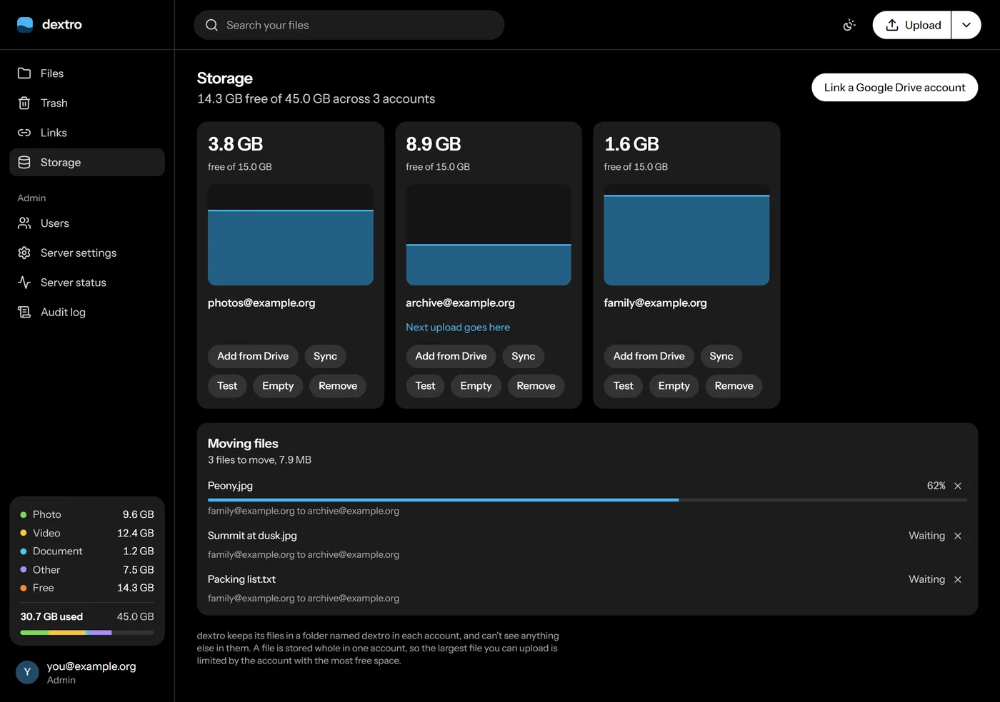
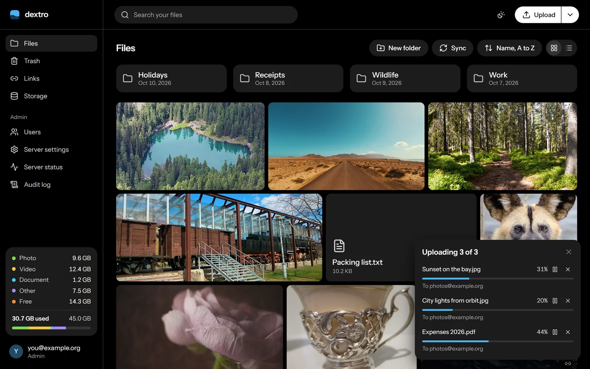
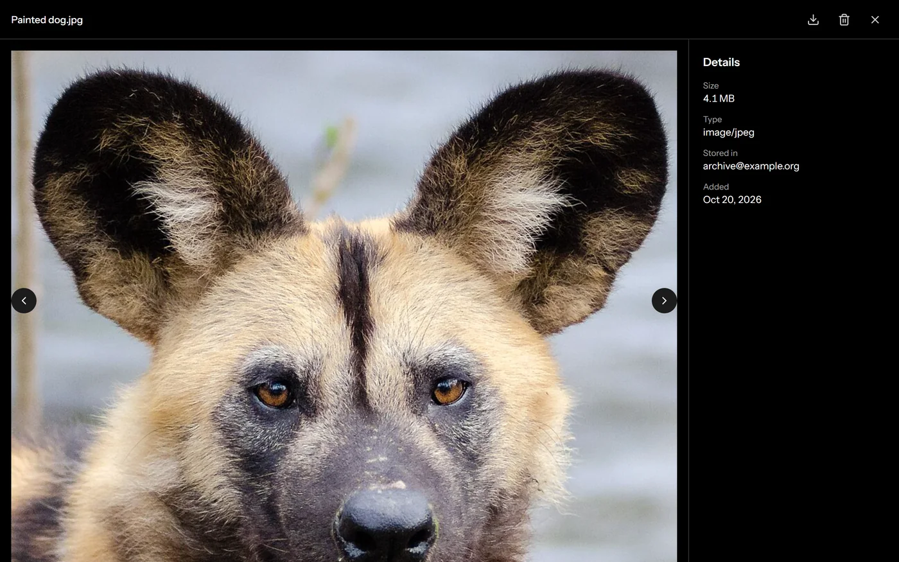
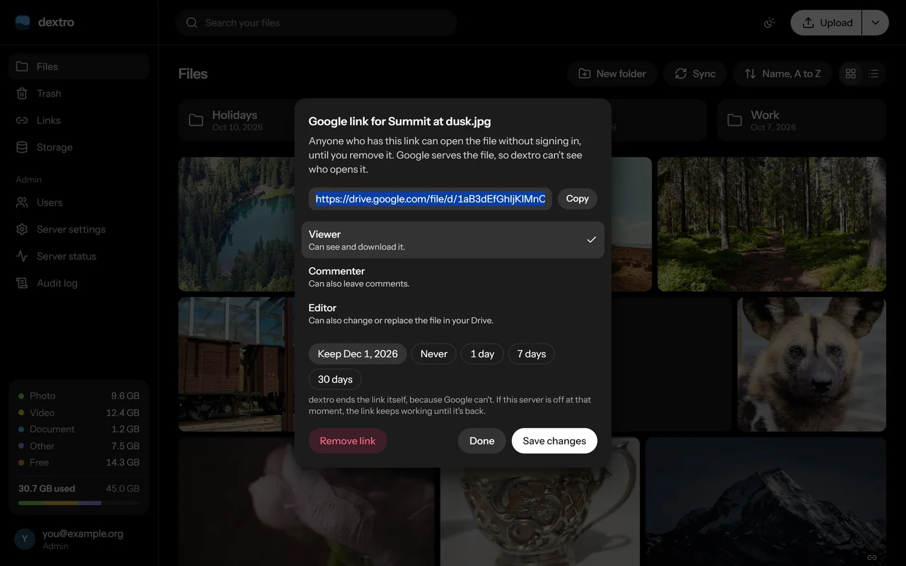
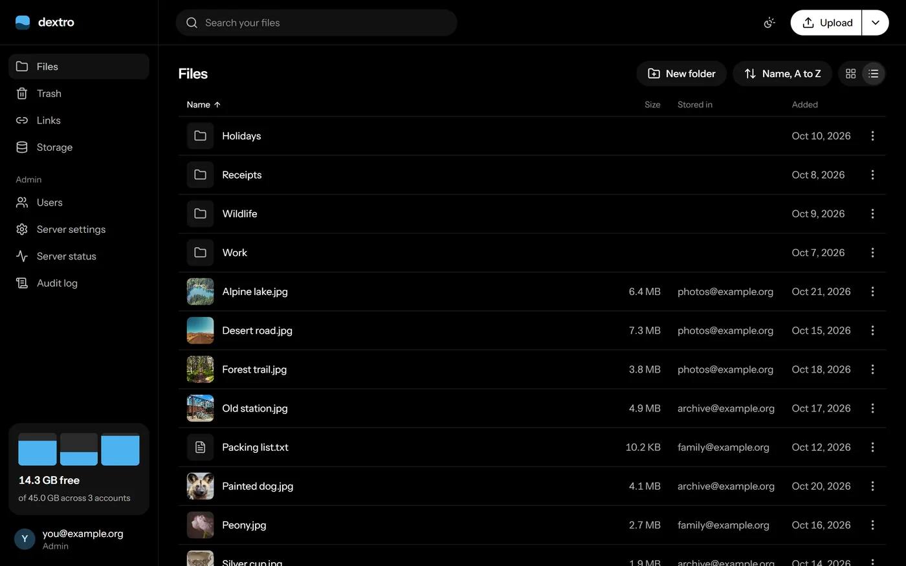
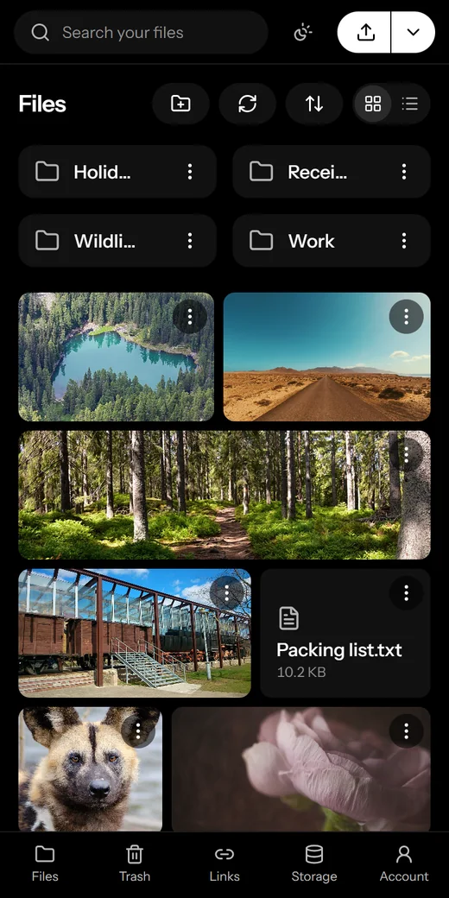

# Tributary

A self-hosted file manager that turns several Google Drive accounts into one pool of storage.

**[Website](https://tributary.swayam.li)** · **[Try the demo](https://tributary.swayam.li/demo)** · **[Self-hosting guide](https://tributary.swayam.li/self-host)** · **[API guide](https://tributary.swayam.li/api-guide)** · **[Changelog](CHANGELOG.md)**

Link your Drive accounts, then upload, organize, preview and share files from one web app. Tributary keeps your files in your own Drive accounts, not on its own server.

<picture>
  <source media="(prefers-color-scheme: light)" srcset="docs/media/files-light.webp">
  
</picture>

## See it in action



[Watch this as a full-quality video](docs/media/demo.mp4).

## What it does

- **One pool from many accounts.** Uploads go to the one you pick, or follow your routing: most free space, round robin or a priority order. An account that can't be reached is skipped.
- **Real folders.** Folders appear in every linked account, inside a Drive folder named `dextro`.
- **Large uploads that survive problems.** Files go up in pieces, so an upload can pause, resume and recover from a lost connection. You can upload a whole folder, or drag one onto the page.
- **File management.** Sort, search, star files, see what's recent, drag files onto folders, and move things to a trash with Undo. Keyboard shortcuts cover search (`/`), trash (Delete), rename (F2) and select all (Ctrl+A). Images, video and PDFs preview in the app.
- **Zip downloads.** Download a folder or a selection as one zip.
- **Moving between accounts.** Move files to rebalance your accounts, or empty one before unlinking it. Each file is copied and checked before the old copy is removed.
- **Google links.** Share one file with a public link, choosing whether people can view, comment or edit, with an optional expiry. These are off until the admin turns them on.
- **Add from Drive.** Bring in files you already have in Drive, using Google's picker.
- **Accounts for other people.** One admin creates users, each with their own files and linked accounts.
- **API keys.** Scripts can upload and read files with a scoped key, including resumable uploads for large files.
- **Warnings when it matters.** A banner says when an account can't be reached or is nearly full, and Reconnect repairs it.
- **Daily database backups.** The Compose files copy the database into a `backups` folder and keep a week.
- **Storage at a glance.** See how much photos, videos and documents take up across the pool.
- **Light and dark themes.** Follows your device, or choose one.
- **Admin commands.** Manage users and settings from the command line.

## Screenshots

<table>
  <tr>
    <td width="50%"><br><b>Your pool.</b> See how full each account is, and follow files moving between them.</td>
    <td width="50%"><br><b>Uploads.</b> Pause, resume, and pick up after a lost connection.</td>
  </tr>
  <tr>
    <td><br><b>Preview.</b> Images, video and PDFs open in the app.</td>
    <td><br><b>Google links.</b> Choose what people can do, and when the link ends.</td>
  </tr>
  <tr>
    <td><br><b>List view.</b> Sort by name, date or size, and see which account holds each file.</td>
    <td align="center"><br><b>On your phone.</b> The whole app works on a small screen.</td>
  </tr>
</table>

These show a demo with made-up accounts and [free sample photos](docs/media/CREDITS.md).

## How it works

Tributary runs as three parts:

| Part | What it does |
|---|---|
| Go server | The API, the background jobs and the database migrations |
| Node web server | Serves the React app and forwards API requests to the Go server |
| PostgreSQL | Keeps accounts, folders, file records and the audit log |

File contents pass through the Go server as a stream on their way to and from Drive. They're never saved on the server, and memory use doesn't grow with file size. Your server's bandwidth is the limit, and a move between accounts uses it twice, once in and once out.

Add from Drive moves no file contents, and neither does the sync. Google serves files opened through a Google link, so that traffic never reaches your server either.

Tributary uses the `drive.file` scope, so it can only see files it created or that you chose in the picker. Anything else in your Drive stays invisible to it.

## Getting started

You need Docker, `make`, and a Google Cloud project.

### 1. Set up Google

In the [Google Cloud console](https://console.cloud.google.com/):

1. Enable the **Google Drive API**.
2. Configure the OAuth consent screen, and add the `drive.file` scope.
3. Create an **OAuth client ID** of type "Web application", with these authorized redirect URIs:

   ```
   http://127.0.0.1:3000/api/v1/auth/google/callback
   http://127.0.0.1:3000/api/v1/storage/google/callback
   ```

While the consent screen is in "Testing" status, every account you link has to be added as a test user, and its token expires after 7 days.

**For Add from Drive**, also enable the **Google Picker API** and create an API key limited to that API. Its allowed sites must include your app's address and `https://docs.google.com/*`.

### 2. Configure

```sh
make env
```

This creates `.env` with random secrets. Then add your Google values to it:

```sh
GOOGLE_CLIENT_ID=your-client-id
GOOGLE_CLIENT_SECRET=your-client-secret
GOOGLE_PICKER_API_KEY=your-key   # optional, turns on Add from Drive
```

> **Back up `ENCRYPTION_KEYS`.** It encrypts your stored Google tokens. Without it, every linked account has to be connected again.

### 3. Start

```sh
make up
```

Open <http://127.0.0.1:3000>. The first account you create becomes the admin, and sign-up closes after that. Then open **Storage** and link a Google Drive account.

`make up` stays in the foreground. To stop the stack and keep its data, press Ctrl+C or run `make down`.

## Settings

Docker Compose reads these from `.env`:

| Setting | Required | What it does |
|---|---|---|
| `POSTGRES_PASSWORD` | Yes | The database password. `make env` sets it. |
| `ENCRYPTION_KEYS` | Yes | Encrypts stored Google tokens, as comma-separated `id:base64` entries of 32 random bytes. `make env` sets it. |
| `ENCRYPTION_KEY_ID` | With several keys | Which key new values use. |
| `PUBLIC_URL` | No | The address browsers use. Defaults to `http://127.0.0.1:3000`. Requests that change data are refused from anywhere else. |
| `GOOGLE_CLIENT_ID`, `GOOGLE_CLIENT_SECRET` | To link accounts | Set both or neither. Without them, Google sign-in and Drive are off. |
| `GOOGLE_PICKER_API_KEY` | No | Turns on Add from Drive. |

To rotate the encryption key, add a new key after a comma and point `ENCRYPTION_KEY_ID` at it. Keep the old key listed, because existing values still need it.

The admin can change the upload limit and turn Google links on or off in **Server settings**.

### Running on a real address

For more uploads at once, run the app over HTTPS, because browsers only use HTTP/2 there: 12 can run instead of 4, up to 3 per account. `make cert` makes a local certificate, and `COMPOSE_PROFILES=https` with `PUBLIC_URL=https://127.0.0.1` in `.env` adds nginx in front. Add the new address to Google's redirect URIs too.

Session cookies are always `Secure`. Chrome accepts them on `http://127.0.0.1`, but any other address needs HTTPS, or sign-in won't stick. If you change `PUBLIC_URL`, update the redirect URIs in Google to match.

## Admin commands

There's one admin. `make admin` runs these on the server:

```sh
make admin cmd="help"
```

| Command | What it does |
|---|---|
| `status` | How the server, accounts and background jobs are doing |
| `sync` | Match Tributary to every linked account now |
| `users` | List every user |
| `create-user <email>` | Add a user and print a temporary password |
| `delete-user <email> --yes` | Delete a user. Leave off `--yes` to see what that does |
| `reset-password <email>` | Print a temporary password, for someone locked out, the admin included |
| `transfer-admin <email>` | Hand the admin role to someone else |
| `links [on\|off]` | Show or set whether people can make Google links |
| `upload-limit [GiB]` | Show or set the largest upload |

For example:

```sh
make admin cmd="create-user someone@example.org"
make admin cmd="links on"
```

Without `make`, run `docker compose exec api /tributary-cli <command>`. In Git Bash, put `MSYS_NO_PATHCONV=1` in front of it.

These show accounts and counts, never what anyone stores, and changes appear in the audit log. In the app, **Server status** shows the same health information and has a **Run now** button for each background job, and the **Audit log** records sign-ins, settings changes, links and permanent deletes.

## Changing the look

Every colour in the app is a named token in one file, [`web/src/theme.css`](web/src/theme.css), with a value for each theme:

```css
:root,
[data-theme="dark"] {
  --background: #000;
  --card: #111;
  --foreground: #fff;
  --water: #4cb3f0; /* storage levels */
}

[data-theme="light"] {
  --background: #fff;
  --card: #f3f3f3;
  --foreground: #0a0a0a;
  --water: #0a6fb0;
}
```

Change a value there and it changes everywhere. The tokens are grouped by purpose: surfaces, text, the main button, lines, danger, storage levels, and shadows.

To add a new token:

1. Add it to both themes in `theme.css`.
2. Map it in the `@theme inline` block in `web/src/index.css`, for example `--color-brand: var(--brand);`.
3. Use it as a class, such as `bg-brand` or `text-brand`.

Components should use token names only, never a colour value. Keep text at a contrast of at least 4.5:1 against its background in both themes.

## Development

| Command | What it does |
|---|---|
| `make tools` | Install the pinned Go tools into `bin/`. The first `sqlc` build is slow on Windows. |
| `make generate` | Regenerate code from the SQL queries and `api/openapi.yaml` |
| `make check-generated` | Fail if generated code is out of date |
| `make build` | Build the frontend and the Go server |
| `make lint` | Run golangci-lint, oxlint and the TypeScript compiler |
| `make test` | Run the Go and web server tests. Docker must be running. |
| `make run` | Run the Go server locally |
| `make dev-web` | Run the Vite dev server, proxying the API to `localhost:8080` |
| `make migration name=add_users` | Create a database migration |

Requirements: Go 1.27, Node 22 and pnpm.

### Where things are

```
api/openapi.yaml     The API contract. Change this first, then run make generate.
cmd/server           Starts the server. Wiring only.
cmd/cli              The admin's command line, tributary-cli. Wiring only.
internal/cli         The admin commands
internal/files       Files, folders, the trash, uploads, zips, moves, links and sync
internal/storage     Linked accounts and the storage pool
internal/provider    What storage has to provide, and the Google Drive adapter
internal/auth        Sign-in, sessions, users and API keys
internal/jobs        Background work
internal/db          Migrations and SQL queries
web/src              The React app, organized by feature
web/server           The production web server
```

Each backend feature has a `handler.go` for HTTP, a `service.go` for rules and a `store.go` for the database. [`CLAUDE.md`](CLAUDE.md) explains the design in full, including the reasoning behind the less obvious decisions.

## Security

- Files are private. The only public access Tributary ever creates is a Google link that a person chose to make, on one file, and only if the admin has turned links on. Every link is listed on one page, audited, and ended when its file goes to the trash.
- Google tokens are encrypted at rest with AES-256-GCM, and the server refuses to start with placeholder secrets.
- Sessions use `HttpOnly`, `Secure` cookies stored hashed, and API keys are stored hashed. Keys can't delete anything permanently or touch links.
- Uploaded content is served with a sandbox policy. Only images, video and PDFs display in the browser, and everything else downloads.
- Every query that loads user data is scoped to that user.

## Docker images

Ready-built images are on Docker Hub as [`swayam5342/tributary-api`](https://hub.docker.com/r/swayam5342/tributary-api) and [`swayam5342/tributary-web`](https://hub.docker.com/r/swayam5342/tributary-web), for amd64 and arm64. [`website/public/docker-compose.yml`](website/public/docker-compose.yml) runs them without building anything, and the [self-hosting guide](https://tributary.swayam.li/self-host) walks through it.

## Reporting a security problem

Please see [SECURITY.md](SECURITY.md).

## Licence

Tributary is released under the [MIT licence](LICENSE).

## Good to know

- **The name.** Tributary used to be called dextro. That's why the folder in your Drive, the database and the `DEXTRO_` settings still use the old name: changing them would lose track of data that's already there.
- **A file lives whole in one account.** Free space adds up across accounts, but the largest file you can upload is limited by the account with the most room.
- **Changes made by hand in Drive mostly aren't copied back.** Deletions are noticed, but renames and moves aren't.
- **The trash is Tributary's own.** It doesn't appear in Drive, and it only empties when you tell it to.
- **Link expiry needs the server running.** Google has no expiry for public links, so Tributary removes them itself. If the server is off at that moment, the link keeps working until it's back.
- **Removing an account or user leaves their files in Drive.** Tributary only forgets them. Deleting a user also leaves any Google links they made working.
- **Moves are one at a time.** Each file costs several Google requests, so moving thousands of small files takes hours. They run in the background, so you can close the browser.
- **Zips take time for many files.** Google takes about a second to start sending each one.
